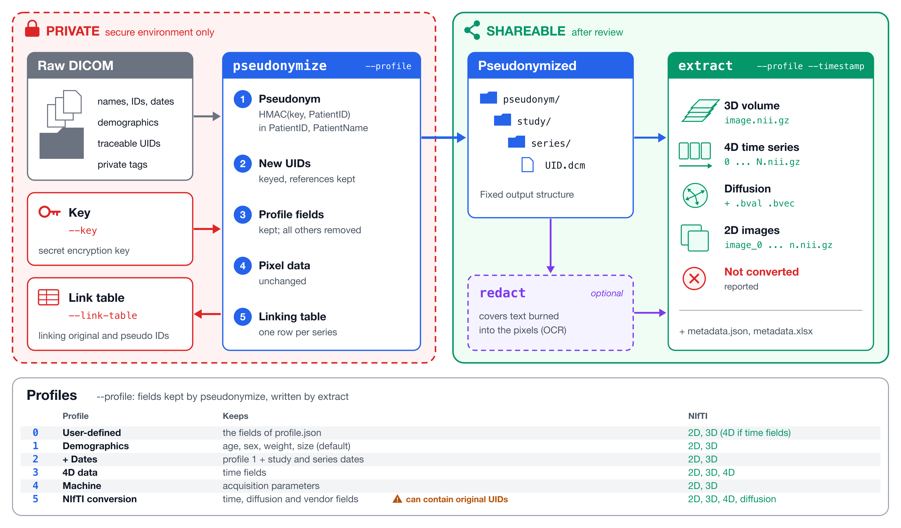

# dicom-pseudo



Pseudonymization of DICOM datasets for research. The package provides two pipelines, which you can use from the
command line or as a Python API:

- **Pseudonymization** (`pseudonymize`): writes pseudonymized DICOM files. 
  It keeps the image and the fields of the selected profile, replaces the patient identifier and all UIDs with keyed pseudonyms, and removes or empties everything else.
- **Extraction** (`extract`): converts each DICOM series to NIfTI images (2D, 3D or 4D), together with the profile's
  metadata as JSON, reproducing the folder structure of its input. 
  It doesn't pseudonymize: run it on the pseudonymized DICOM files.

Pseudonymization writes a **linking table** between original and pseudonymized identifiers, which must be kept separately from the data. 
Two helper commands complete the toolkit: `redact` removes text burned into the pixel data, and `compare` compares two NIfTI files.

Recommended workflow: `pseudonymize` (raw DICOM → pseudonymized DICOM) → optionally `redact` → `extract` (pseudonymized DICOM → NIfTI). 
The extraction then only sees pseudonymized data, and needs no access to the raw data, the key or the linking table.

## Contents

- [Install](#install)
- [Quick start](#quick-start)
- [Concepts](#concepts)
- [Pseudonymization: `pseudonymize`](#pseudonymization-pseudonymize)
- [Extraction: `extract`](#extraction-extract)
- [Arguments](#arguments)
- [Profiles](#profiles)
- [Python API](#python-api)
- [Example scripts](#example-scripts)
- [Other commands](#other-commands)
- [Tests](#tests)
- [Limitations and good practice](#limitations-and-good-practice)

## Install

```bash
conda create -n pseudo python=3.12
conda activate pseudo
pip install --upgrade pip
pip install .
```

Requires Python 3.10 or newer.

```bash
python -m venv pseudo
source pseudo/bin/activate
pip install --upgrade pip
pip install .
```

Redacting burned-in text is optional, because Microsoft Presidio is a large dependency:

```bash
pip install '.[presidio]'
python -m spacy download en_core_web_lg
brew install tesseract   # Tesseract OCR engine; on Linux: apt install tesseract-ocr
```

## Quick start

Pseudonymized DICOM files
```bash
pseudonymize /data/study -o /release/dicom -k /secrets/project.key -l /secrets/linking_table.xlsx
```

NIfTI images and metadata, from the pseudonymized DICOM files (same folder structure)
```bash
extract /release/dicom -o /release/nifti
```

The key file is created at the first run. Keep it, and the linking table, in a protected location outside the data you share. 
The same key gives the same pseudonyms in later runs.

## Concepts

### Secret key and pseudonyms

Pseudonyms are keyed hashes (HMAC-SHA256) of the original identifier. 
Without the key, they can't be recomputed, and low-entropy identifiers such as numeric patient IDs can't be recovered by trying every possible value.

`--key-file PATH` reads the key from a file, or creates a new random key file (readable only by its owner) if it
  doesn't exist yet. 
  Alternatively, set the environment variable `DICOM_PSEUDO_KEY`.
- **The key defines the scope of linkage.** Reuse the same key for all exports of a project, so a patient keeps the same pseudonym. 
  Use a new key for each separate project or data release, so the releases can't be joined with each other.
- The key file and the linking table are refused if they are inside the output folder.

### Linkage: patient or study level

`--linkage patient` (default) gives one pseudonym per patient (per identifier value): all studies of a patient share it, which allows longitudinal analyses.

`--linkage study` gives one pseudonym per study, computed from the identifier and the original StudyInstanceUID. 
All UIDs are also mapped per study, so a UID shared between two studies (e.g. a frame of reference) is replaced differently in each. 
- Studies of the same patient then can't be linked in the released data. 
- The linking table still lists the patient-level pseudonym of each study, so the key holder can re-link them.

### DICOM information

| Element | Result |
|---|---|
| Identifier (`--identifier`) | Pseudonymized; the pseudonym is written to PatientID and PatientName |
| UIDs (study, series, ...) | Replaced by keyed UIDs. Standard UIDs (SOP class, transfer syntax, ...) are kept |
| Fields kept in all profiles | Kept unchanged ([list](#fields-kept-in-all-profiles)) |
| Fields in selected profile | Kept unchanged ([profiles](#profiles)) |
| File meta information | Reduced to the elements a valid file needs |
| Pixel data | Unchanged (to redact burned-in text, see [`redact`](#redact-burned-in-text)) |
| All other fields | Emptied (zero-length value, so the file structure stays valid); sequences keep only their UIDs |
| De-identification flags | `PatientIdentityRemoved = YES`; `DeidentificationMethod` records the tool version, profile, identifier and linkage |
### Input files

The input can be a folder, searched recursively, or a single DICOM file. 
DICOMDIR index files and non-DICOM files (README, reports, …) are ignored and never copied. 
Damaged files, and files without the chosen identifier, are skipped: the first ones are listed at the end of the run, and all of them in `<linking table>_errors.csv`, next to the linking table (it contains original paths: keep it with the linking table).

### Output structure

Pseudonymized output folders and file names are rebuilt from pseudonymized values only:

```
OUTPUT/<Pseudo_Identifier[:32]>/<Pseudo_StudyInstanceUID>/<Pseudo_SeriesInstanceUID>/
```

`extract` reproduces the structure of its input, so applied to the pseudonymized files it writes the NIfTI images to the same folders.

### Linking table

`--link-table PATH` (`.xlsx` or `.csv`, required) has one row per DICOM series (and input/output folder). 
It contains the original identifiers, so treat it like the key. 
An existing table is updated: re-running replaces the rows of the same series, and new series are added.

| Column | Content |
|---|---|
| `Original <identifier>` | Original identifier value |
| `Pseudonym <identifier>` | Pseudonym written in the data (patient or study level) |
| `Patient pseudonym <identifier>` | Patient-level pseudonym (allows re-linking study-level data) |
| `Linkage` | `patient` or `study` |
| `Original / Pseudonymized StudyInstanceUID`, `… SeriesInstanceUID` | Original and pseudonymized UIDs |
| `Modality`, `SeriesNumber`, `SeriesDescription`, `BurnedInAnnotation` | From the original data |
| `Input folder`, `Output folder` | Relative input folder(s) and pseudonymized output folder |
| `Number of files` | Number of DICOM files of the series |

## Pseudonymization: `pseudonymize`

```bash
pseudonymize INPUT [-o OUTPUT] [-p PROFILE] [-i IDENTIFIER] [--linkage {patient,study}] -l LINK_TABLE [-k KEY_FILE] [-n PROCESSES]
```

Writes one pseudonymized DICOM file per input file: `OUTPUT/<pseudonym>/<study UID>/<series UID>/<SOPInstanceUID>.dcm`. 
If the same instance (SOPInstanceUID) appears twice in the input, it is written once and the duplicate is reported.
**Parallel processing.** `-n PROCESSES` with more than 1 process pseudonymizes the input folders in parallel, one task per folder

## Extraction: `extract`

```bash
extract INPUT [-o OUTPUT] [-p PROFILE] [-t TIMESTAMP]
```

Converts each DICOM series to NIfTI, reproducing the folder structure of the input: the files of `INPUT/<folder>/` are written to `OUTPUT/<folder>/`, without renaming folders. 
If a folder contains several series, each series gets a subfolder `<SeriesNumber>_<Modality>` (with the SeriesInstanceUID appended if that name isn't unique).
Applied to raw DICOM files, the output keeps their folder names and the profile's fields as they are.

| Series | Files written |
|---|---|
| 3D volume | `image.nii.gz` |
| 4D series with time points in the files (e.g. fMRI, perfusion, dynamic series) | `0.nii.gz`, `1.nii.gz`, … `t.nii.gz` (one volume per time point) + `timestamps.json` |
| Diffusion series (b-values found by dicom2nifti) | `image.nii.gz` (4D), `image.bval` and `image.bvec` |
| 2D images: no slice geometry (CR, DX, MG), or single slices and localisers rejected by dicom2nifti | `image.nii.gz`, or `image_0.nii.gz`, `image_1.nii.gz`, …, `image_n.nii.gz` for several images |
| All series | `metadata.json`: the profile's fields (see [Profiles](#profiles)); binary fields (e.g. vendor private headers) as `<binary, N bytes>` |

**4D time points.** A 4D series (several images at each slice position) is written as one NIfTI per time point. 
The time points are read from the files: the first field that splits the series into more than one time point, each covering the same slice positions, is used:

1. `TemporalPositionIdentifier`
2. `NumberOfTemporalPositions`: with the files sorted by InstanceNumber, the k-th image at each slice position belongs to time point k
3. `ContentTime`, `AcquisitionTime`, `TimeStamp` (GE private `0019,1024`)

`-t KEYWORD` forces one of these fields for the 4D series; 4D series where it doesn't work are reported. 3D and 2D series aren't affected.

## Arguments

| Argument | `pseudonymize` | `extract` | Values | Default |
|---|---|---|---|---|
| `INPUT` | ✓ | ✓ | Folder or single DICOM file | required |
| `-o, --output` | ✓ | ✓ | Output folder | `INPUT_pseudonymized` / `INPUT_extracted` |
| `-p, --profile` | ✓ | ✓ | `0`–`4`, see [Profiles](#profiles) | `1` |
| `-i, --identifier` | ✓ | | Identifier DICOM keyword | `PatientID` |
| `--linkage` | ✓ | | `patient`, `study` | `patient` |
| `-l, --link-table` | ✓ | | `.xlsx` or `.csv` file | required |
| `-k, --key-file` | ✓ | | Key file, created if missing | required |
| `-n, --processes` | ✓ | | folders processed in parallel | `1` |
| `-t, --timestamp` | | ✓ | Timestamp DICOM keyword | automatic detection (4D series) |

## Identifiers

The value is read from the first of these tags that holds a non-empty value:

| Identifier | DICOM tags | Note |
|---|---|---|
| `PatientID` | PatientID (0010,0020) | Recommended: one pseudonym per patient |
| `StudyID` | StudyID (0020,0010) | one pseudonym per study |
| `AccessionNumber` / `AgfaID` | AccessionNumber (0008,0050), then private tag (7fdd,1013) | one pseudonym per examination |

Whatever the identifier, the pseudonym is written to PatientID and PatientName. 
The identifiers are configured in `src/dicom_pseudo/core/config/identifiers.json`.

## Profiles

A profile chooses which fields are kept **on top of** the fields kept in all profiles. 
The profiles are defined in `src/dicom_pseudo/core/config/profiles.json`; tags can be given as hex strings (`"0x00101010"`) or keywords (`"PatientAge"`), optionally grouped by category.

| Profile | Use | Fields kept on top of the common fields |
|---|---|---|
| `0` | User-defined | The fields of `profile.json` |
| `1` (default) | Demographics | PatientAge, PatientSex, PatientWeight, PatientSize, PatientSizeCodeSequence, PatientBodyMassIndex |
| `2` | Demographics + date | Profile 1 + StudyDate, SeriesDate |
| `3` | 4D data | ContentTime, AcquisitionTime, TimeStamp (GE private 0019,1024), TemporalPositionIdentifier, NumberOfTemporalPositions, needed by `extract` for the time points of 4D series. No demographics |
| `4` | Machine | Equipment, acquisition and reconstruction parameters, general to the machine and not to the installation or site (below). No demographics |
| `5` | NIfTI conversion | Temporal and diffusion fields, and the vendor private tags dicom2nifti needs for advanced imaging. No demographics. **Can relesase original UIDs and protocol names** |

A new predefined profile is added by adding an entry to `profiles.json`: `"6": {"description": "...", "fields": {...}}`.

### Fields kept in all profiles

Configured in `src/dicom_pseudo/core/config/fields_to_keep.json` and `groups_to_keep.json`:

### User-defined profile (profile 0)

```bash
modify_profile          # opens profile.json in the default editor
modify_profile --path   # prints the path of profile.json
```

`profile.json` is a dictionary of DICOM keywords and tags.
Tags can be looked up in the [DICOM standard](https://dicom.nema.org/medical/dicom/current/output/chtml/part06/chapter_6.html).

## Python API

The pipelines can be called from Python with the same arguments as the commands. 
Configuration errors (unknown profile or identifier, key or linking table inside the output, …) raise `SystemExit` with a message. 
Files that can't be processed are reported and skipped; they don't raise.

```python
from dicom_pseudo.pseudonymization import pseudonymization
from dicom_pseudo.extraction import extraction

pseudonymization(
    input_root='/data/study',                 # folder or single DICOM file
    output_root='/release/dicom',             # outside the input
    profile=1,                                # 0-4
    identifier='PatientID',                   # PatientID, StudyID, AccessionNumber, AgfaID
    key_file='/secrets/project.key',          # .key, outside the output
    link_table='/secrets/linking_table.xlsx', # .xlsx or .csv, outside the output
    linkage='patient',                        # 'patient' or 'study'
    processes=1,                              # more than 1: folders processed in parallel
    progress_bar=True,
)

extraction(
    input_root='/release/dicom',              # pseudonymized DICOM files (folder or single file)
    output_root='/release/nifti',             # same folder structure as the input
    profile=1,                                # metadata fields written to metadata.json
    time_stamp=None,                          # time points of 4D series: None = automatic
    progress_bar=True,
)
```

Lower-level building blocks, e.g. for your own pipeline:

| Module | Main functions |
|---|---|
| `dicom_pseudo.core.settings` | `select_profile(profile)`: fields and groups to keep; `FIELDS_TO_KEEP`, `IDENTIFIERS`, `LINKAGES` |
| `dicom_pseudo.core.pseudonym` | `load_key(key_file)`, `pseudonym(value, key)`, `pseudo_uid(uid, key)` |
| `dicom_pseudo.core.identity` | `identify(dataset, identifier, key, linkage)` returns a `SeriesIdentity` (original/pseudonymized IDs, UIDs, output folder) |
| `dicom_pseudo.core.files` | `find_dicom_files(folder)`, `group_by_series(files)`, `save_dicom(dataset, path)` |
| `dicom_pseudo.pseudonymization.pipeline` | `pseudonymize_dicom(...)`: one file |
| `dicom_pseudo.extraction.pipeline` | `group_by_folder_and_series(files, input_folder)`, `extract_series(files, output_folder, fields, four_d)` |
| `dicom_pseudo.extraction.nifti` | `write_nifti(files, output_folder, four_d)`, `convert_2d(path, output_file)` |
| `dicom_pseudo.redaction` | `redaction(input_root, output_root, fill='contrast', padding_width=25)` |
| `dicom_pseudo.compare_nifti` | `compare_nifti_files(file1, file2, tolerance=1e-5)` |


## Example scripts

The `examples/` folder contains scripts that can be run on your own data:

| Script | Content |
|---|---|
| `01_command_line.sh DICOM_FOLDER WORK_FOLDER` | Pseudonymized DICOM files and NIfTI images extracted from them (2D/3D from profile 1 data, 4D from profile 3 data), from the command line |
| `02_python_api.py DICOM_FOLDER WORK_FOLDER` | Pseudonymization and extraction with the Python API, then a summary of the linking table and the NIfTI overview |

Each script writes `WORK_FOLDER/secrets/` (key, linking tables: keep, don't share) and `WORK_FOLDER/release/` (data to share).

## Other commands

### `redact`: burned-in text [NOT TESTED]

```bash
redact INPUT [-o OUTPUT] [-f {contrast,background}] [--padding PIXELS]
```

Detects text in the pixel data with OCR (Microsoft Presidio and Tesseract) and covers it with boxes. 
Run it on the **pseudonymized** DICOM files: files keep their relative paths, and only the pixel data changes. 
`--fill` sets the box colour (`contrast`, the default, or `background`); 
`--padding` sets the padding around the image for the text detection (default 25 pixels). 
It needs the optional install described in [Install](#install). 
The linking table column `BurnedInAnnotation` and the warning at the end of `pseudonymize` show the series flagged as containing burned-in annotations.

### `compare`: NIfTI files

```bash
compare FILE1 FILE2 [-t TOLERANCE]
```

Compares two NIfTI files, header fields and voxel values (within `TOLERANCE`, default `1e-5`). 
For example, convert a series from the original and from the pseudonymized DICOM files and check that the images are identical.

## Tests

```bash
pip install -e '.[test]'
pytest
```

The tests in `tests/` run on DICOM files built from the pydicom example data (patients, studies and series from the pydicom DICOMDIR test files, synthetic 3D and 4D series, 2D projections, overlays, private elements, broken files, duplicates). They cover:

- settings and profiles
- keys, pseudonyms and pseudonymized UIDs
- tables that open in Excel
- the pseudonymization: no original values outside the kept fields, original pixel data, UIDs and references, linking table, reruns, study linkage, run lock, command line
- parallel processing: same results as one process, folders sharing a lock never processed together
- the extraction: input structure reproduced, 2D/3D/4D images, time points, same images from the original and the pseudonymized files

The tests marked `real_data` also run on a sample of a real dataset: 14 series (about 1000 files) from several manufacturers, with Siemens mosaics and 2D, 3D and 4D series, chosen automatically. By default the dataset is `../_data/ibash_learners`, next to the repository; set the `DICOM_PSEUDO_TEST_DATA` environment variable to use another one. These tests are skipped when the dataset is absent. They check:

- profile 1 leaves no original values, UIDs or private elements
- profile 5 leaves no identity, including in the vendor private headers
- the extraction of profile 5 data gives the same images as the original data
- with profile 1, Siemens mosaics are reported, not written as 2D tiles
- `-n 4` gives the same results as `-n 1`

The sample is pseudonymized with a new test key, assertion messages show only counts and field names, and all derived data is deleted at the end. They take about a minute; to skip them:

```bash
pytest -m "not real_data"
```

## Limitations

- **Private tags** are removed (except those kept by profile 5). Vendor-specific information they hold is therefore not available in the pseudonymized DICOM files: e.g. Siemens mosaic and Philips single-frame fMRI/diffusion can't be converted to NIfTI from them (`extract` reports them), and diffusion b-values and directions are lost. 
- **`extract` on raw data** doesn't pseudonymize: folder names and the profile's fields are copied as they are. 
- **NIfTI conversion** depends on dicom2nifti for volumes: series it rejects (inconsistent slice spacing, multi-frame 2D, ...) are reported and not written.

##


